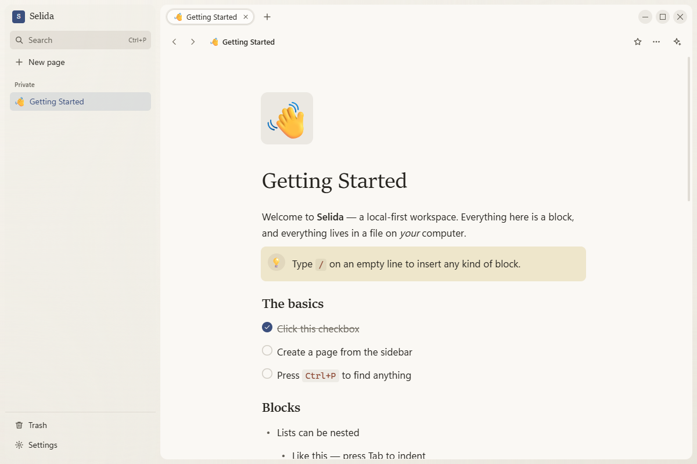
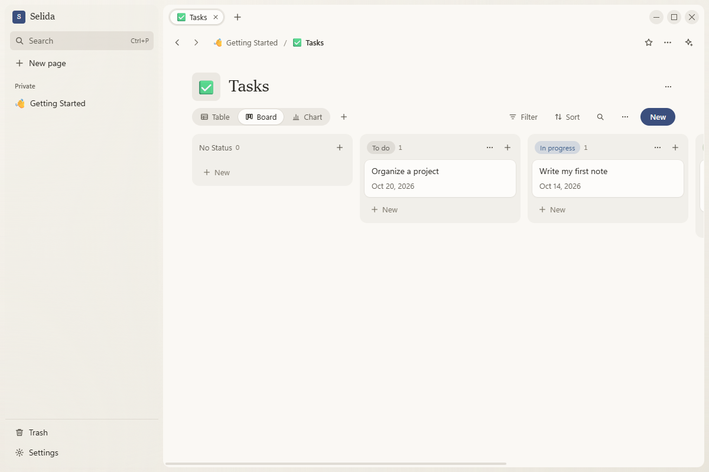
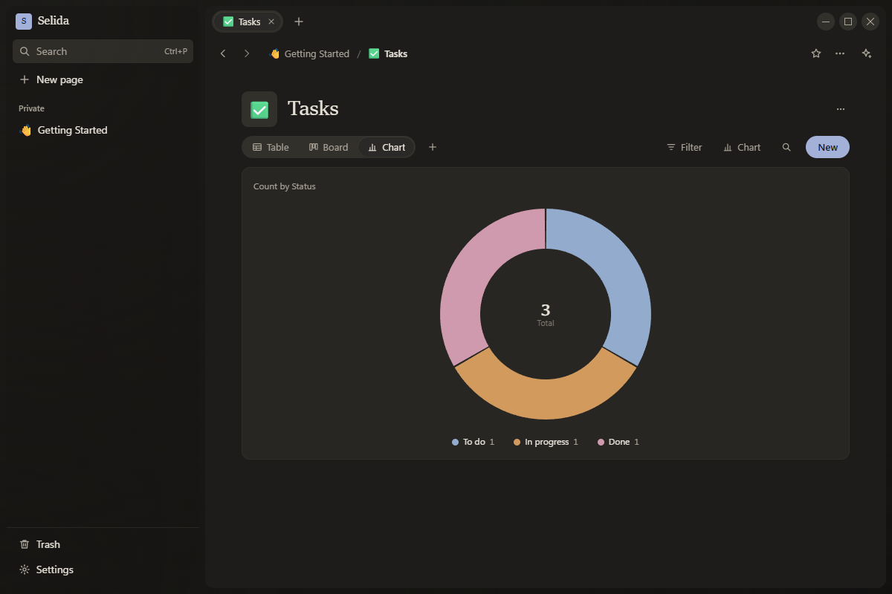
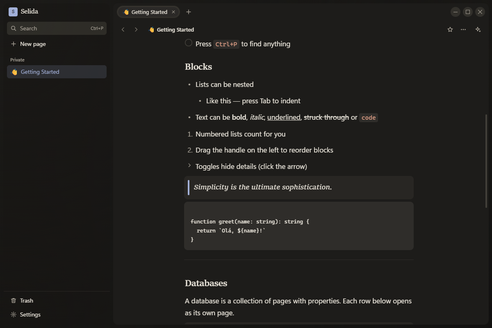
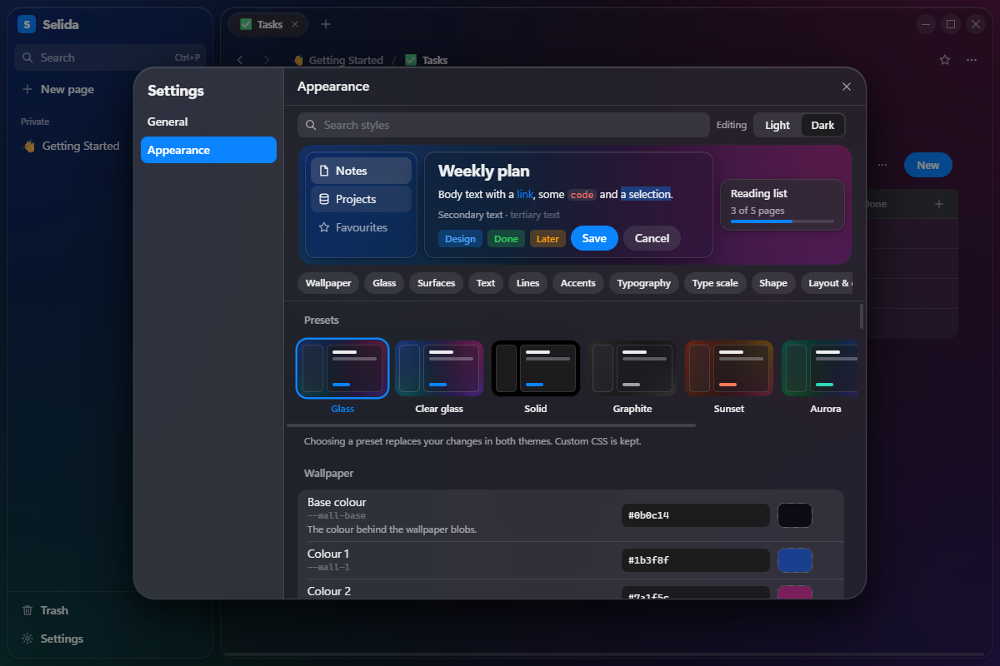

# Selida

A quiet place to write and keep things.

Selida is a notes app for your desktop. Pages are made of blocks, databases are made of pages, and everything lives in one file on your computer.



## What it does

**Write.** Headings, lists, to-dos, toggles, quotes, callouts, code and images. Type `/` for any block, or use Markdown shortcuts as you go.

**Organise.** Databases with table, board, list, gallery, calendar and chart views. Show the same database in several pages, each with its own filters.

**Find.** `Ctrl+P` searches everything.

**Go back.** Every page keeps a version history. Compare, restore, or restore as a copy.

**Start the day.** Today shows your calendar, the tasks that are open and a phrase worth reading: Marcus Aurelius, the Dhammapada, Thoreau, or one of your own.

**Record meetings.** Record your microphone and what the computer plays while you take notes. The transcript is made on your own machine by whisper.cpp, and your Claude writes up the notes from it. The audio never leaves the computer.

**Ask.** Summarise, continue or rework text with your own Claude, through the Claude Code app on your machine. Nothing enters a page until you accept it.

**Meet Herman.** The assistant has a face: an old man drawn in a single line, who keeps a corner of the window. Ask him about a page or about your day. Now and then he says one short thing he noticed, written in advance and chosen on your computer, with no AI involved. Settings → Herman quiets him or sends him away.

**Make it yours.** Zen is the default look. Every colour, font, size and radius can be changed in Settings → Appearance.

| | |
|---|---|
|  |  |
|  |  |

## Principles

- **Yours.** Your notes are a SQLite file on your disk. No account, no server.
- **Still.** The app makes no network requests of its own, apart from loading images you link to, reading your calendar if you connect one, and downloading the transcription program and a speech model, once, when you ask for it.
- **Light.** One small window, a short list of dependencies.
- **Careful.** The interface runs sandboxed, and nothing you paste or import is trusted.

## Run it

You need [Node.js](https://nodejs.org) 22 or newer.

```bash
npm install
npm run dev
```

To build an unpacked app into `release/`:

```bash
npm run pack
```

## Work on it

```bash
npm test
npm run typecheck
```

The code is in `src/`:

- `main/` — the Electron main process: storage, files, version history, AI, the briefing, meetings, Herman.
- `preload/` — the narrow bridge the interface is allowed to use.
- `renderer/` — the interface: editor, databases, shell, appearance.
- `shared/` — types both sides agree on.

All style values live in one file, `src/renderer/src/styles/tokens.css`. Components only refer to them.

## Keys

| | |
|---|---|
| `Ctrl+P` | Find |
| `Ctrl+N` | New page |
| `Ctrl+T` / `Ctrl+W` | New tab / close tab |
| `Ctrl+\` | Hide the sidebar |
| `Ctrl+J` | Herman, the assistant |
| `Ctrl+Alt+T` | Today |
| `Ctrl+Alt+M` | New meeting |
| `Ctrl+Shift+L` | Light / dark |
| `/` | Insert a block |

## License

[MIT](LICENSE)

---

*Selida* is Greek for *page*.
