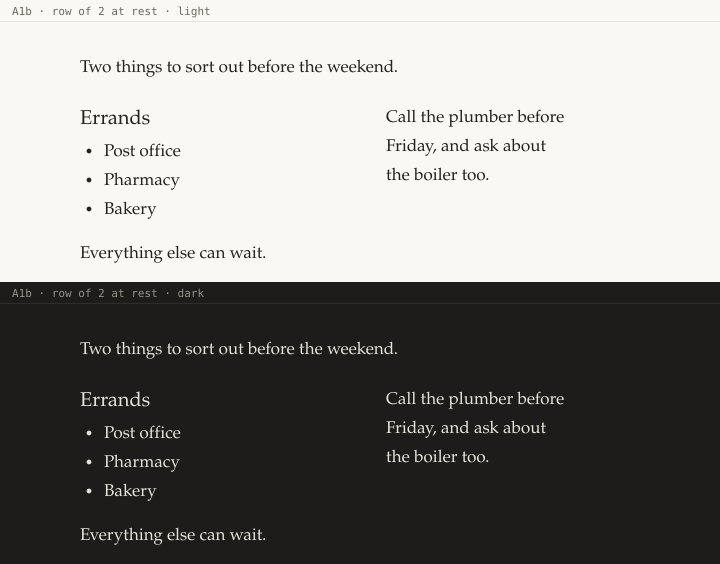
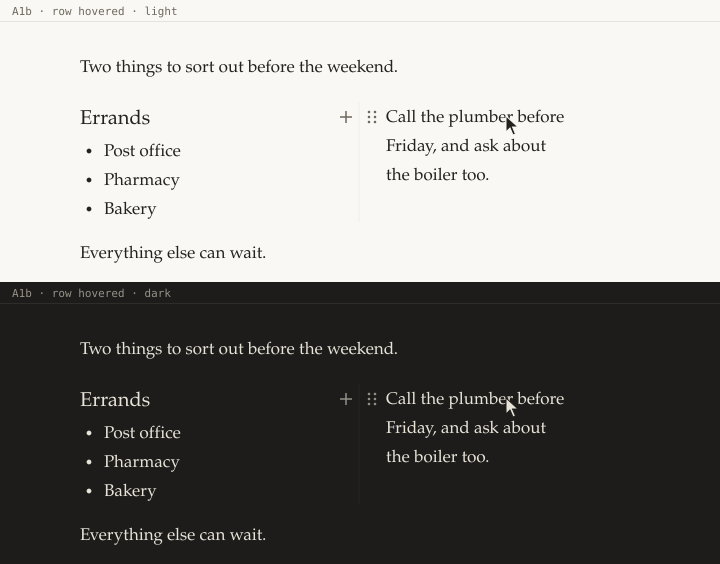
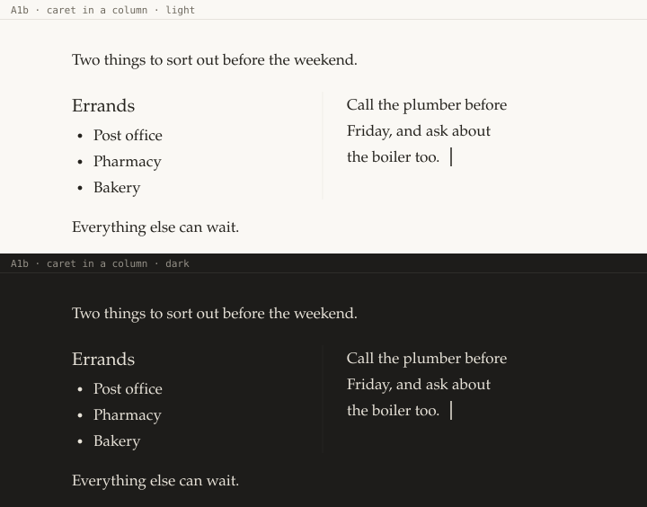
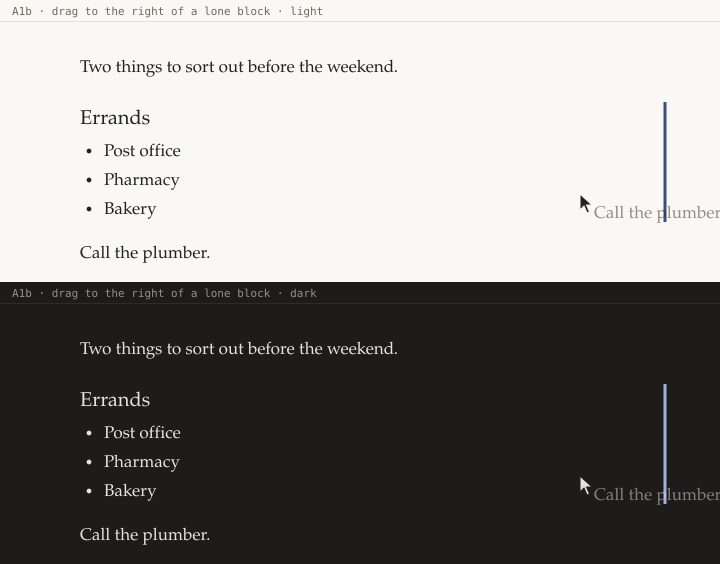
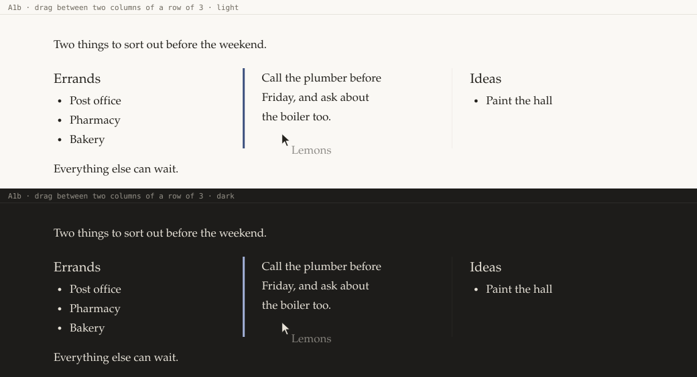
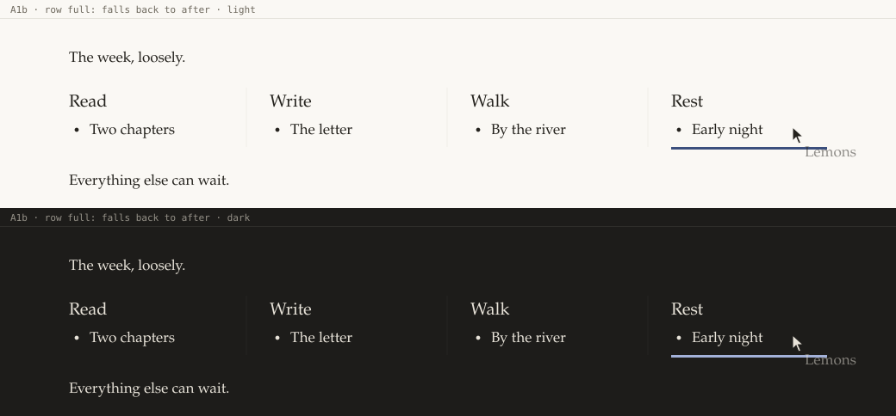
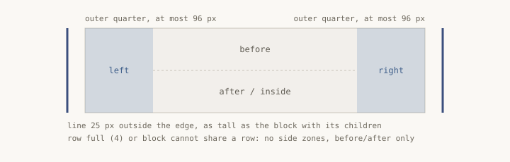

# A1b · The side drop line, and the rules between columns

_sel-designer, 2026-10-24, for release 0.9.0 items A1a (rules, gutters) and A1b (side drop line).
Mockups are SVG, light above dark, drawn at 1:1 from the tokens on `release/0.9.0`._

## Why it looks like this

A column should cost one gesture and show nothing it does not need. At rest a row of columns is
just text side by side: no borders, no fills. Two quiet marks exist, and only when they help:

- a **rule** (one hairline) in each gap between columns, while the row is hovered, has the caret,
  or has a drag over it, so you can see where one column ends and aim at it;
- a **drop line** (the same 3 px accent line as today's before/after line, turned upright) while
  you drag a block to the side of another.

The drop line is drawn **in the same place as the rule**. In a row, dropping between two columns
just lights the rule up. The eye learns one position, not two.

Flow: hover the block, drag its handle (⋮⋮) to the side of another block, and drop. That is one
gesture. The keyboard path stays A1a's block menu entry ("Place beside the previous block").

## States

| State | Mockup | What to see |
|---|---|---|
| Rest |  | Two columns at text width (2 × 254 px, gap 52 px). Nothing between them. |
| Hover |  | The pointer is on column 2. The rule appears in the gap, and column 2's gutter (+, ⋮⋮) shows on each side of it without touching it. |
| Keyboard focus |  | The caret is in column 2: the rule shows (`:focus-within`), and no gutter appears. |
| Drag to the side of a lone block |  | A vertical accent line 25 px right of the heading, as tall as the heading with its children. The block being dragged stays where it is, as today. |
| Drag between columns (row of 3) |  | The drop line replaces the rule in gap 1, and gap 2's rule stays visible. |
| Row full (4) |  | The side zones do not exist, so the pointer falls back to after. A horizontal line runs under column 4, as wide as that column. There is no refusal mark and no toast. |
| Zones (diagram) |  | Where the pointer has to be. |

After the drop, the row looks like **Rest**. The result is announced (see below).

Edge states:
- **Empty columns** (from `/2 columns`): each column is one empty paragraph that is still one line
  tall, so it can be clicked. With the caret in the row, the rules show where the other columns are.
- **One very long column** beside a short one: both are top-aligned, and the rule runs the full
  height of the row (the tallest column).
- **A row that wraps** (window narrower than n × column minimum + gaps): no rules, because a rule
  in the page's gutter would read as a quote bar. Side drops still work.
- **From 2 to 3 columns**: when the third column is dropped, the row widens from `--page-width` to
  `--database-width` (A1a's rule). It snaps with no width transition, because animating a reflow of
  text for 300 ms is busier than one jump.

## Exact values

All from `tokens.css`, `editor.css` and `ui.css` as they are on the branch, plus A1a's
`--column-min`.

**Rule (A1a, shown by A1b during a drag)**
- Line: `var(--hairline)` (0.5 px) wide, colour `var(--border)`.
- Position: centred **25 px right of the left column's edge**. The gap is 52 px
  (`.blk-beside { column-gap: 52px }`), and the next column's gutter fills it: + is a 24 px circle
  at −52…−28 and ⋮⋮ one at −26…−2, 2 px apart. 25 px from the left edge is the middle of that 2 px
  slot, so the rule never crosses a control. Relative to the right column: `left: -27px` minus
  half the hairline.
- Height: the whole row, top to bottom of the tallest column.
- Shown on `.blk-beside:hover`, `.blk-beside:focus-within`, and while the drop target is in the
  row (a class such as `.blk-beside.is-drop-row`, set from `ctrl.ui` `drop`). Chromium does not
  update `:hover` during a native HTML drag, so `:hover` alone will not show it mid-drag.
- Appears with `opacity` over `var(--duration-fast)` `var(--ease)`, as the gutter does. Under
  reduced motion the global rule already makes this instant.

**Side drop line (A1b)**
- 3 px wide, `var(--accent)`, `border-radius: var(--radius-pill)`, `z-index: 2`,
  `pointer-events: none`. These are the values of `.blk.drop-before::before` today, turned upright.
- `drop-left`: centred 25 px left of the target `.blk` (`left: calc(-25px - 1.5px)`). `drop-right`:
  centred 25 px right of it (`right: calc(-25px - 1.5px)`). In a row, both are the same x as the rule.
- `top: 0; bottom: 0` of the target `.blk`, so it is as tall as the block **with its children**
  (the whole column for a head).
- Only one line at a time. Left of column k and right of column k−1 are the same place with the
  same result. The line is drawn on whichever block the pointer is over, and the pixels are the same.

**Zones** (`onDragOver` in `PageEditor.tsx`)
- Side zones are checked first: the outer quarter of the block's row, **capped at 96 px**. The plan
  says "outer quarter". On a 560 px paragraph that is 140 px, which would catch ordinary up/down
  drags whose pointer drifts right. With the cap, the `inside` zone (`x > left + 56`) keeps most of
  the width.
- Offered only when the target can share a row (A1a's `canShareRow`) and the row has room. If not,
  before/after/inside work exactly as today.
- Nice to have: the 52 px gap between two columns is part of the nearer column's side zone, since
  that is where the line is drawn and where people will aim.

**Pseudo-elements: a note for the developer.** `.blk::before` (before) and `.blk::after`
(after, inside) already draw the drop lines, and the side lines can reuse them (left on `::before`,
right on `::after`), because a block has only one drop position at a time. The rule then needs its
own element: an `aria-hidden` ``, the first child of each non-first
column, `position: absolute; top: 0; bottom: 0`. To make it row-tall, let the columns stretch
(`align-items: stretch` on `.blk-beside`). Columns have no fill, so nothing visible changes and
content stays at the top. Any other way that gives the same pixels is fine.

## Keyboard and screen reader

- No keyboard drag in this item (agreed in the plan). The keyboard path is the block menu:
  Esc, Shift+F10 (or the Menu key), "Place beside the previous block", Enter.
- Rules and lines are decoration: `aria-hidden`, never focusable.
- After a side drop, `announce()` says "Placed beside" / "Colocado ao lado" (A1a's key). The row
  is a `role="group"` labelled "{n} columns" / "{n} colunas" (A1a).
- Focus does not move on a drop. The dragged block keeps its selection, as today.

## Copy

No new words beyond A1a/A1b's: "Placed beside" / "Colocado ao lado", "{n} columns" / "{n}
colunas". Herman says nothing: layout is not a moment for the persona.

## Open question

**What a horizontal line means on a column's head.** Inside a row, the before and after lines
are drawn across one column only. The after line sits at the bottom of that column's `.blk`, which
includes its children. Visually, that reads as "into this column, at its end". The plan does not
say where such a drop lands, and `'after'` on a head that is not last would today put the block
between two heads and split the row. Proposal: inside a row, a horizontal drop never splits it.
"After" on a head makes the block the column's last child, and "before" on the first head puts it
before the row. "Before" on any other head is not offered (the pointer gets the side zone instead).
This needs sel-dev to confirm in `placeForDrop`.

## Screens to capture (S0)

`columns-drag-right` (in the plan) should match **Drag to the side of a lone block** above.
Suggested addition: `columns-hover` (a row of 2 with the pointer on column 2: the rule and gutter),
because the rule is the one new mark people will see often, and a still image is where its
contrast in both themes can be checked.
