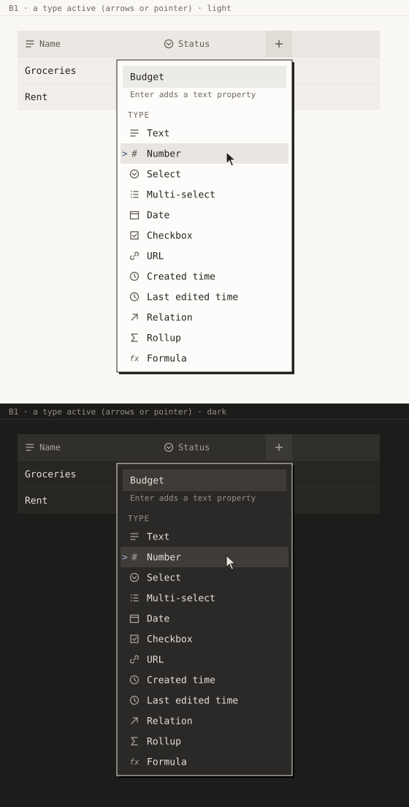

# B1 · Add a property with its name

_sel-designer, 2026-10-24, for release 0.9.0 item B1. Mockups are SVG, light above dark, drawn at
1:1 from the tokens on `release/0.9.0`._

## Why it looks like this

Today a new property arrives named "Text" and has to be opened again to be renamed. The add menu
now asks for the name first, in the same field and the same place where `PropertyMenu` keeps it.
Adding and editing then look like one thing, and the first keystroke after "+" is already the name.

Flow: "+", type the name, Enter (a text property) or click a type. That is 1 to 2 clicks plus
typing, down from 3 clicks plus typing. It is the same from the table's "+", "Add a property" on a
row page, and the properties panel.

## States

| State | Mockup | What to see |
|---|---|---|
| Just opened (empty) |  | The name field is focused with its ring, the placeholder is "Property name", and the types are below. There is no hint: an empty field explains nothing, so it says nothing. |
| Name typed |  | "Budget" is in the field. One line of hint appears under it, aligned with the typed text. |
| A type active (arrows or pointer) |  | After ArrowDown, or with the pointer on a row: the menu's usual active row (tint plus the accent `>` prompt). The field keeps its text and loses its ring. |
| pt-BR |  | The same, translated (see Copy). |
| After Enter, in a table |  | The new column is scrolled into view, and its first cell is the grid's active cell. |

Other states:
- **Relation**: the database picker replaces the menu, as today, and the typed name is kept (it
  wins over the target's title). **Formula**: the formula editor opens with the typed name.
- **A name that already exists** gets " 2" silently (`uniqueName`, as today).
- **A very long name** is capped by `L.MAX_NAME_LENGTH` (the field's `maxLength`, as in
  `PropertyMenu`). The field scrolls its text, and the popover never grows.
- **Loading / error**: none in the menu. The add is applied locally at once. A failed write is
  reported by the actions' existing `notifyWriteFailed`, and nothing new is shown here.
- **No rows yet**: after the add, the "+" header keeps focus (there is no first cell to move to).

## Exact values

- **Popover**: `.ui-popover.glass-thick`, which is `--glass-thick-bg`, a 1 px `--frame` line, and
  `--shadow-popover` (3 px offset, square). Placement under "+", right edges aligned
  (`bottom-end`), as the table's add menu opens today.
- **Width: fixed at 240 px** for the whole add menu. This is the value already used by
  `.db-prop-menu-name:only-child`. Fixed so the popover does not change width when the hint
  appears, and so B3's column menu (also 240 px) and this menu are the same object.
- **Name field**: wrapper `.db-prop-menu-name` (padding 8 px 8 px 4 px). `.ui-input`: height
  `--control-height` (30 px), padding 0 10 px, `--fill-3`, `--text-ui` (13 px). Focused, it has
  `box-shadow: 0 0 0 3px var(--focus-ring)`. The placeholder is in `--text-secondary` (the global
  `::placeholder` rule).
- **Hint**: `--text-xs` (11 px), `--text-tertiary`, one line, padding 2 px 10 px 0 inside the
  wrapper so it starts under the field's text (x = 8 + 10 px). Shown only while the field has text.
  It is part of the wrapper, so the list moves down by one line (16 px) the moment you type. That
  is a small shift, and it moves the list away from the field you are typing in, never under the
  pointer.
- **Menu**: `.ui-menu` (padding 5 px). Header `.ui-menu-header` ("Type" / "Tipo"): `--text-xs`,
  `--weight-medium`, letter-spacing 0.08em, uppercase, `--text-tertiary`. Items `.ui-menu-item`:
  min-height 28 px (`--control-height` − 2), padding 3 px 10 px, an 18 px icon slot, an 8 px gap,
  and the label in `--text-ui`. Active: `--bg-menu-active`, `--text-menu-active`, and `>` in
  `--accent` at left 2 px. All of these are reused as they are; nothing new.
- **After adding**: the grid's active cell style `.db-td.is-focused` (inset 2 px `--focus-ring`).

No new tokens and no new raw values. The 240 px already exists in `database.css`. Twelve types
fit without scrolling (the popover is about 430 px tall), and the `.ui-popover` max-height handles
a short window.

## Keyboard and screen reader

| Where | Key | Does |
|---|---|---|
| Field, with text | Enter | Adds a Text property with that name and closes |
| Field, empty | Enter | Moves into the list (same as ArrowDown). It never adds an unnamed Text |
| Field | ArrowDown | Moves into the list: the first type becomes active |
| List | ArrowUp / ArrowDown, Home / End | Moves along the types (`.ui-menu`'s own keys) |
| List, first type | ArrowUp | Goes back to the field, caret at the end |
| List | Enter | Adds that type with the typed name (or the translated type name if empty) |
| Anywhere | Esc | Closes and creates nothing |
| Field | typing | Never filters the list: the name is the name, not a search |

- Popover `aria-label` "Add a property" / "Adicionar uma propriedade". The field has a visible
  placeholder and the same `aria-label` "Property name" / "Nome da propriedade".
  `aria-describedby` points to the hint while it is shown.
- The list keeps `role="menu"`, `role="menuitem"` and `aria-activedescendant` (`ui/Menu.tsx`).
- Announced after adding: "Added {name}" / "Propriedade {name} adicionada", through `announce()`.

## Copy

| Key | en | pt-BR |
|---|---|---|
| popover label | Add a property | Adicionar uma propriedade |
| field placeholder and label | Property name | Nome da propriedade |
| list header | Type | Tipo |
| hint | Enter adds a text property | **Enter cria como texto** (see below) |
| announced | Added {name} | Propriedade {name} adicionada |
| types | Text · Number · Select · Multi-select · Date · Checkbox · URL · Created time · Last edited time · Relation · Rollup · Formula | Texto · Número · Seleção única · Seleção múltipla · Data · Caixa de seleção · URL · Criado em · Última edição · Relação · Agregação · Fórmula |

**The pt-BR hint is too long for one line.** "Enter cria uma propriedade de texto" is 35
characters. In IBM Plex Mono at 11 px (6.6 px each) that is 231 px, and the hint has 214 px
(240 − 8 − 10 − 8). It would wrap onto two lines. "Enter cria como texto" (21 characters, 139 px)
says the same thing in a menu that is already about properties. The en line (26 characters,
172 px) fits as planned. If the longer line is kept, it may wrap to two lines (no ellipsis on an
instruction). At `--font-scale` above 1 it may wrap in English too, and that is fine.

Herman says nothing here.
