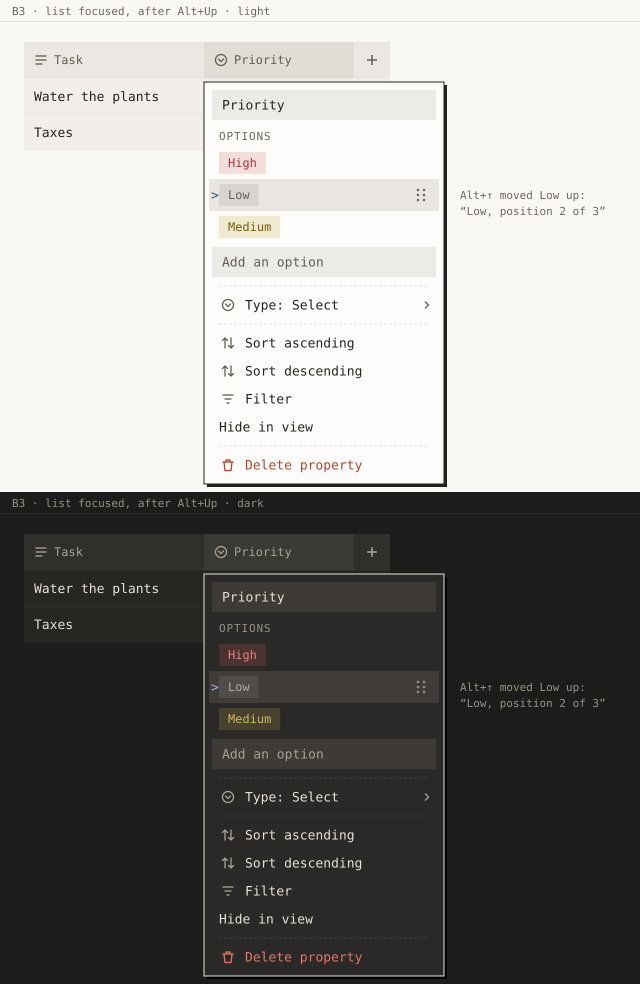
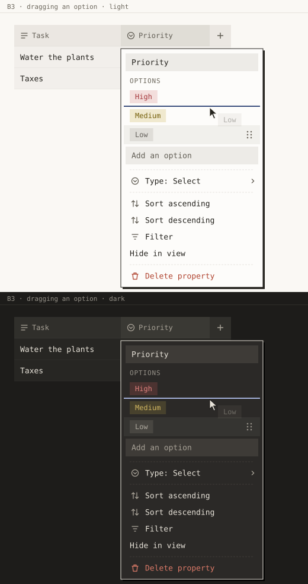

# B3 · A select's options in its column menu

_sel-designer, 2026-10-24, for release 0.9.0 item B3. Mockups are SVG, light above dark, drawn at
1:1 from the tokens on `release/0.9.0`._

## Why it looks like this

A select's options are part of the property, so they belong in the property's menu, right under
its name, before anything about sorting or filtering. Today you have to open a cell, then its
picker, then an option: 3 clicks before editing one, and there is no way to reorder. Now: click
the header, then click the option, which is 2 clicks. Reordering is a drag, or Alt+arrows, on the
list itself.

Nothing new is invented. Each option is the same tag it is in a cell, the rows are the menu's rows,
the edit pane is the cell picker's `OptionEditPane`, and the add field is a `.ui-input` like the
name field above it.

## States

| State | Mockup | What to see |
|---|---|---|
| Default |  | Name field (focused, text selected, as today), the "Options" header, three tags, the "Add an option" field, then the rest of the menu |
| Hover |  | The row under the pointer gets `--bg-hover`, and its ⋮⋮ handle appears at the right |
| Keyboard focus, after Alt+↑ |  | The focused option has the menu's active row (tint plus the accent `>`) and its handle. "Low" moved up one place, and the reader hears "Low, position 2 of 3" |
| Dragging |  | A 2 px accent line where the option will land. Rows do not slide, and the dragged row keeps its tint |
| Empty |  | The header and the add field, nothing else. There is no "No options yet": the placeholder already says what to do |
| Many options, long name |  | Nine options. The list shows 6½ rows and scrolls inside itself. The add field and the rest of the menu stay put. The long name ends in an ellipsis and its full text is in `title` |
| An option opened |  | `OptionEditPane` replaces the menu in the same popover: Back, the name (focused, selected), Delete option, and the colours with a check on the current one |
| pt-BR |  | The whole menu in Portuguese, with no English left |

Other states:
- **Multi-select**: identical. The section depends on the property, not on a cell's value.
- **A name that already exists**: when typed in the add field, nothing is added. The field clears
  and the existing option scrolls into view. Nothing is lost, because it was the same name.
- **Delete**: one click in the pane, undoable with Ctrl+Z, as in the cell picker today. There is
  no confirmation. After it, the list comes back with focus on the next option (the previous one
  if it was the last, the add field if none are left).
- **The Tasks database**: its core selects still show their options. Project and Labels hold the
  user's own options, so everything above applies. Priority is different: its four options P1–P4
  have constant ids that the app reads (`TASK_PRIORITIES` in `src/shared/tasks/index.ts`, "P1 to
  P4, in that order"). **Recommended**: rename and recolour stay allowed there, but reordering and
  deleting are not offered. That means no handle, Alt+arrows do nothing, and "Delete option" is
  absent from the pane, never disabled. The cell picker allows deleting them today, so the
  developer should check whether anything relies on their order or presence before B3 makes them
  easier to reach. _Open question._
- **Loading / error**: none in the menu. Writes are local, and a failed write is reported by the
  actions' existing `notifyWriteFailed`.

## Exact values

- **Popover**: `.ui-popover.glass-thick`, anchored under the header as today. **Width fixed at
  240 px** for `PropertyMenu` (the value already in `.db-prop-menu-name:only-child`), so every
  column menu, with or without options, and B1's add menu are the same size, and the menu does not
  change width as options are added or renamed.
- **Section header** "Options" / "Opções": `.ui-menu-header` exactly (`--text-xs`,
  `--weight-medium`, 0.08em, uppercase, `--text-tertiary`, padding 6 px 10 px 3 px). It is placed
  5 px in from the popover edge so it lines up with the menu's own headers.
- **Option row**: height `--row-height` (32 px). The row box is the same as `.ui-menu-item`
  (5 px from the popover edge, padding-left 10 px), so the `>` marker sits where it does on every
  menu row and the tags line up with the menu labels below them.
  - Tag: `.db-tag` with `tagStyle(color)` (`--c-<name>` on `--c-<name>-bg`), 22 px tall,
    padding 0 9 px, `--text-sm`, `--weight-medium`. Max width is the row minus the handle area
    (36 px). Past that, `.db-tag-label` ends in an ellipsis, and the full name goes in `title`.
  - Handle ⋮⋮: the same grip as blocks and table rows, in `--text-tertiary`, in a 24 px area at
    the row's right, `opacity: 0` at rest and 1 on row hover or focus, `cursor: grab`. It sits on
    the right because the left of a menu row belongs to the `>` prompt.
  - Hover: `--bg-hover` (as `.db-menu-row:hover`). Focus (`:focus-visible`): `--bg-menu-active`,
    `--text-menu-active`, `>` in `--accent` at left 2 px, and no outline ring, as `.ui-menu-item.is-active`.
- **List height**: `max-height: calc(var(--row-height) * 6.5)` (208 px), `overflow-y: auto`,
  `overscroll-behavior: contain`. The plan says "at most 6 rows". The half row is the refinement:
  it tells you there is more without any extra mark. Scrollbar: the global thin one.
- **Add field**: wrapper padding 4 px 8 px, `.ui-input` (30 px, `--fill-3`, `--text-ui`), and the
  placeholder "Add an option" in `--text-secondary` (global `::placeholder`). Focus: the 3 px
  `--focus-ring`, as the name field.
- **Drop line** while dragging: 2 px `--accent` across the row width, between two rows. It is
  2 px, not the page's 3 px, because the database already marks drops with 2 px
  (`.db-th.drop-before { box-shadow: inset 2px 0 0 var(--accent) }`), and this is the database's
  menu.
- **Separators**: `.ui-menu-separator` (dashed hairline, `--border-strong`) after the add field,
  as between the existing groups.
- **Edit pane**: `OptionEditPane` unchanged (`.db-option-edit-head`, Back as `.db-mini-button`
  24 px with a left chevron, `.db-menu-row` 30 px rows, `.db-menu-heading` "Colour", 16 px
  `.db-swatch` circles). The popover keeps its 240 px width and its anchor, so it does not jump.

No new tokens and no new raw values (240 px exists already, and 6.5 is a multiplier of a token).

## Keyboard and screen reader

Tab order inside the menu: name field → options list (**one** Tab stop) → add field → the menu
items (arrow keys, as today).

| Where | Key | Does |
|---|---|---|
| List | ArrowUp / ArrowDown, Home / End | Moves among options. Nothing wraps (`rovingTarget`) |
| List | Enter or Space | Opens the option in the pane |
| List | Alt+ArrowUp / Alt+ArrowDown | Moves the focused option one place, keeps focus on it, and announces its place |
| List | Esc | Closes the menu (as anywhere in it) |
| Add field | Enter | Adds the option (next colour, as `addOption` does), clears the field, and keeps focus there for the next one. The list scrolls to show the new tag |
| Add field, empty | Enter | Nothing |
| Pane | Esc | **Back** to the list (not close), focus on that option |
| Pane, name field | Enter | Saves the name and goes Back |

- List: `role="list"`, `aria-label` "Options" / "Opções". There is no list role when empty (an
  empty list is an axe error and says nothing). Each item is a `listitem` with
  `aria-posinset`/`aria-setsize`, holding one focusable button named after the option (roving
  `tabIndex`). The handle is `tabIndex={-1}`, `aria-label` "Move {name}" / "Mover {name}", and is
  for the pointer only.
- Alt+arrows match the Alt+Shift (tree) and Ctrl+Alt (board) moves in spirit. It is a vertical
  list in a popover, so plain Alt is enough and does not clash with anything in the menu.
  It goes in `PAGE_KEYS` and the shortcuts screen only if those list popover-local keys; today
  they do not.
- Announced: after a move, "{name}, position {n} of {total}" / "{name}, posição {n} de {total}".
  After adding, **recommended**: "{name} added" / "Opção {name} adicionada". The plan says
  no announcement, but a reader user hears only the field going empty, which sounds the same as
  failing.

## Copy

Every string of `PropertyMenu` goes through `database/copy.ts`.

| en | pt-BR |
|---|---|
| Options | Opções |
| Add an option | Adicionar uma opção |
| Move {name} | Mover {name} |
| Back | Voltar |
| {name}, position {n} of {total} | {name}, posição {n} de {total} |
| {name} added _(recommended)_ | Opção {name} adicionada |
| Type: {type} | Tipo: {type} |
| Number format | Formato do número |
| Number · Percent · Currency | Número · Porcentagem · Moeda |
| Edit formula… | Editar fórmula… |
| Sort ascending · Sort descending | Ordenar crescente · Ordenar decrescente |
| Filter | Filtrar |
| Hide in view | **Ocultar na visualização** (not "nesta": 26 characters would be cut at 240 px) |
| Delete property | Excluir propriedade |
| Related to: {name} · Relation: {name} · Property: {name} | Relacionada a: {name} · Relação: {name} · Propriedade: {name} |
| Limit: 1 page · Limit: no limit | Limite: 1 página · Limite: sem limite |
| Two-way: show on {name} | Duas vias: mostrar em {name} |
| Calculate: {fn} · Rows: {rule} | Calcular: {fn} · Linhas: {rule} |

The `{type}` values are B1's names ("Seleção única", and so on). Labels with a `{name}` may end in
an ellipsis at 240 px. That is `.ui-menu-label`'s existing behaviour, and the full text is
already in the item. `OptionEditPane`'s own words ("Delete option", "Colour", colour names) stay
English in this release (out of scope). In pt-BR the pane will be the one English spot. That is
noted, not fixed here.

Herman says nothing here.
